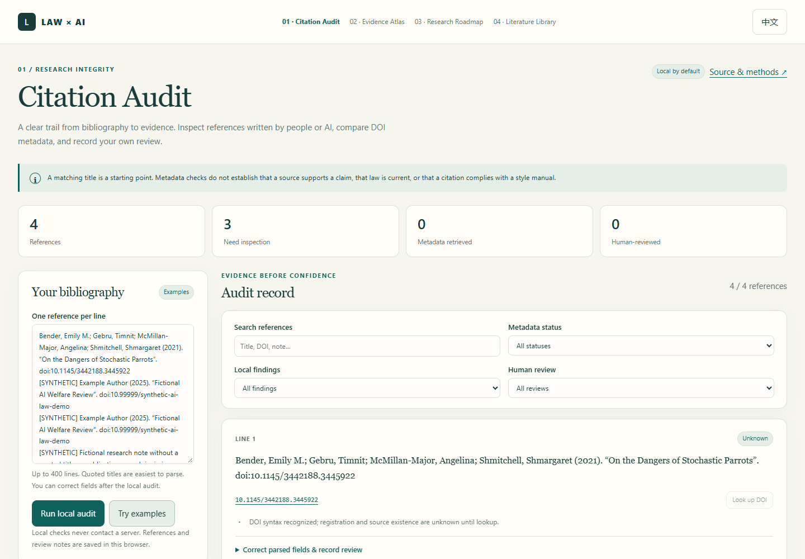

# 01 · Citation Audit / 引注核验

**A transparent bibliography workspace for AI-assisted legal research.**

[Open the tool](https://josephsun1854.github.io/01-citation-audit/) · [Methods and boundaries](docs/methods.md) · [Research questions](docs/research.md) · [中文说明](#中文说明)



Citation Audit helps a researcher inspect references written by people or AI, compare DOI records with Crossref, and preserve a separate human review trail. It is part of a Law × AI portfolio concerned with social law and the governance of large language models.

## A usable workflow

1. Paste a bibliography, one reference per line, and run the local audit.
2. Inspect line-specific findings. Correct the extracted title, year and authors when the parser cannot determine them.
3. Optionally enable Crossref requests for this session. Query one DOI or the next ten eligible DOI records.
4. Read the original source. Record its relevant page, passage and your judgment under human review.
5. Export JSON to continue later, or CSV / Markdown for a research record.

The **Try examples** button loads one real bibliographic reference and three explicitly synthetic cases. The real example uses DOI `10.1145/3442188.3445922`; its title, year and author metadata were retrieved from Crossref during development. The application still starts its lookup as **Unknown** until you choose to request a record. Synthetic DOI examples never leave the browser.

## What it checks

| Layer | Checks | What remains unknown |
| --- | --- | --- |
| Local parser | DOI candidates, quoted titles, publication-year candidates, source URLs, duplicate references | Whether a source exists, and whether parsed fields are correct |
| Optional Crossref lookup | Registered metadata, DOI identity, normalized title similarity, publication-year agreement, at least one overlapping author surname | Whether the bibliography accurately represents a complete edition or author list |
| Your review | Editable review state and a note with an evidence location | The application never makes this judgment for you |

The metadata statuses are **Unknown**, **Metadata agrees**, **Possible mismatch**, and **Lookup error**. A Crossref `404` stays unknown: other DOI registration agencies and incomplete records exist. Imported metadata is labeled as a snapshot and remains unknown until independently refreshed.

**Metadata agreement never verifies a cited claim, legal validity, legal effect, or compliance with a formal citation manual.** This tool uses deterministic rules, not an LLM or a fabricated model score. It can audit AI-generated output without pretending to have generated or evaluated legal reasoning.

## Privacy and portability

- No accounts, analytics, external fonts, telemetry, or third-party application scripts.
- Bibliography text, notes and fields stay in browser local storage until exported or cleared.
- Crossref is opt-in for each session. A request sends only a DOI identifier to `api.crossref.org`; ordinary connection information is visible to that service.
- Source links open only when you choose them. GitHub Pages itself receives normal website requests.
- JSON imports are size- and schema-checked before an explicit replacement confirmation. Derived DOI fields are reconstructed from the reference text.
- CSV exports neutralize spreadsheet formula prefixes; Markdown exports escape user-provided markup.
- Browser storage is not encrypted. Use the clear button on a shared computer and keep an exported copy before clearing browser data.

## Run and verify

This is a static application with no build step and no runtime dependencies. Serve the directory over HTTP; browser ES modules generally do not run correctly by double-clicking an HTML file.

```sh
python -m http.server 8000
```

Open `http://localhost:8000`. For the automated checks, use Node.js 20 or newer:

```sh
node --check core.js
node --check app.js
node --test
```

`npm run check` and `npm test` provide equivalent shortcuts; no package installation is needed. GitHub Actions runs the syntax checks and Node tests on pushes and pull requests. The tests cover incomplete records, ambiguous authors, metadata disagreement, network failures, synthetic markers, import rejection and export injection handling.

## Project files

`core.js` contains the testable parser and comparison rules; `app.js` supplies browser interaction; `index.html` and `styles.css` provide the responsive bilingual interface. [Methods](docs/methods.md) documents comparison thresholds and known limitations. [Research questions](docs/research.md) describes a future evaluation protocol without claiming any completed benchmark.

## 中文说明

**用于 AI 辅助法学研究的透明书目核验工作区。** 本项目关注社会法与大语言模型治理中的研究可信度，帮助使用者检查人工或 AI 生成的参考文献，并保留从元数据查询到人工证据判断的记录。

把参考文献按“每行一条”粘贴到输入框，运行本地核验，逐项检查 DOI、题名、年份与重复条目。解析不可靠时，可在条目中修正候选字段。勾选本次会话的 Crossref 授权后，才能发送 DOI 查询登记元数据。随后应自行阅读原始来源，在审阅状态与笔记中记录页码、段落和判断，最后导出 JSON、CSV 或 Markdown。

界面支持中英切换。示例包含一条真实书目与三条明确标注的合成案例；合成 DOI 不外发。元数据查询状态分为“未知”“元数据一致”“可能不一致”和“查询失败”，与“已检查来源”等人工审阅状态分开。导入的元数据仅作为快照展示，重新查询前仍标为未知。

**元数据一致不代表引文观点已被来源支持，不代表法律有效，也不代表符合任何正式引注手册。** 本工具不调用语言模型，不生成虚构的模型评分。没有 DOI 的法条、判例、书籍或纸本资料也不应因此被判定为无效。

工具默认本地处理，不含分析统计与第三方脚本；完整条目和笔记保存在当前浏览器。可选查询只发送 DOI，但 Crossref 能看到普通连接信息。本地存储未加密，在共享设备使用后请清空，并在清理浏览器数据前先导出备份。

## License

MIT · Copyright © 2026 JosephSun1854.
